# InterMap：把相互作用指纹计算从"跑不动"变成"几分钟"

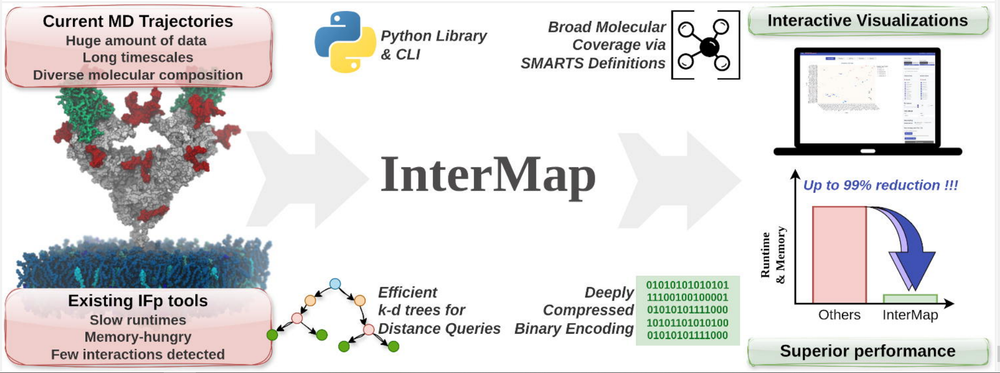

**论文信息**：

- **题目**：《InterMap：大规模分子系综中相互作用指纹的加速检测》（*InterMap: Accelerated Detection of Interaction Fingerprints on Large-Scale Molecular Ensembles*）
- **状态**：**已正式发表**——*Journal of Chemical Theory and Computation*（JCTC，ACS），2026 年，第 22 卷，第 14 期，第 7370–7381 页；DOI 10.1021/acs.jctc.6c00083；2026 年 5 月在线发表、7 月刊出[1]。此前发布的 bioRxiv 预印本（2025-12-15，DOI 10.64898/2025.12.15.694195，CC-BY 4.0）仍可获取。
- **作者**：
    - **Ernesto Fajardo-Díaz（第一作者）**：巴黎西岱大学（Université Paris Cité）；与 R.G-A. 共同撰写初稿并实现软件
    - **Emmanuelle Bignon / François Dehez**：洛林大学，CNRS，LPCT（UMR 7019）；Bignon 参与概念框架与数据收集，Dehez 负责结果分析、讨论与经费
    - **Yasaman Karami / Roy González-Alemán（共同通讯）**：洛林大学，CNRS，Inria，LORIA（González-Alemán 另属 LPCT UMR 7019）；共同提出研究并开发主要思路
- **开源**：GitHub `Delta-Research-Team/intermap`（MIT License），文档站 `Delta-Research-Team.github.io/intermap`

相互作用指纹（IFP）把连续原子运动压成一条二进制向量，是聚类、变构分析和机器学习特征工程里的常用工具。但它的计算瓶颈很直接：要在一个又一个轨迹帧里做海量原子间距离判断，分子内 IFP 尤其昂贵。InterMap 针对这个瓶颈做了三层优化，把 9 条真实 MD 轨迹上的 IFP 分析，从"跑不动"变成"几分钟"级别。本文从问题、技术、基准与实战四个角度对它做一次系统梳理。

## 一、引言：MD 后处理的瓶颈与 IFP 的价值

### ① 数据在生产，分析在掉队

GPU 与算法进步让 MD 模拟的规模从千原子级跃升到百万原子级、时间尺度推进到微秒甚至毫秒级。与之呼应，FAIR 数据仓库也在兴起：MDDB 定位欧洲生物模拟数据统一基础设施，MDRepo 是社区贡献的蛋白模拟开放仓库，DynaRepo 聚合了超过一毫秒的模拟并预计算了分析结果[1]。

这些资源把问题推到了台面上：**数据生产能力已经远超后处理分析能力**。大量轨迹产出了，谁来解读？

### ② IFP 是什么、为什么值钱

IFP 的做法，是把分子间或分子内"有没有某种经典相互作用"离散化成 0/1 向量。一个向量条目对应一个原子对（或残基对）在指定帧里是否满足某种作用（π-堆积、氢键、盐桥、疏水接触、卤键、水桥等）。向量简洁、可比较、可检索。

它的应用早已超出"数一数有几根氢键"：构象亚态聚类用 IFP 区分结合模式；变构通路分析用 IFP 追踪长程非共价耦合；在结构药物发现里，IFP 或类似交互描述被用作机器学习/深度学习特征，服务结合亲和力预测、姿态排序与虚拟筛选[2]。

关键场景是**分子内 IFP**：蛋白-蛋白、蛋白-DNA、DNA-DNA 等同一分子内部的交互分析。这类分析的信息量大，但计算代价也大——这是后续所有性能问题的起点。

### ③ 现有工具的谱系与共同瓶颈

IFP 软件大体分两族（论文 Table 1）：docking 导向的工具（PLIP、Arpeggio、ODDT、Binana、IChem、PyPLIF、LUNA、fingeRNAt 等），以及面向 MD 轨迹的工具（ProLIF[3]、getContacts[4]、MD-IFP[5]、MD-LR[6]）。前一族服务的姿态数少、计算轻；后一族才是长轨迹处理的主力。

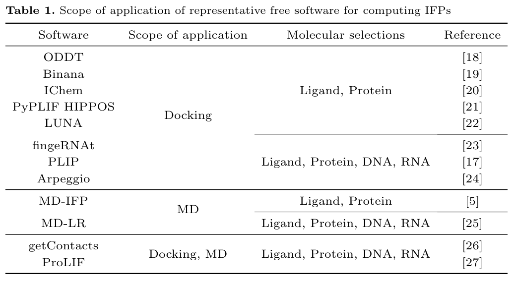

MD 一族各有短板。getContacts 基于 VMD，原子选择依赖严格的命名约定，且若干交互未对配体定义[4]；MD-IFP 只能处理配体-蛋白或蛋白A-蛋白B，核酸与分子内 IFP 都不支持[5]；MD-LR 派生自 PLIP，只认 GROMACS 生态的格式，核酸不能作为独立配体，配体还需归为单一分子组，也无法计算分子内 IFP[6]。ProLIF 功能最全面，但原子集一大就力不从心。这些短板的共同根源是一致的：距离计算的时间与空间复杂度——轨迹越长、体系越复杂、一旦涉及分子内 IFP，工具就集体掉链子。生态层面，Jaeger-Honz 等人 2024 年曾对 IFP 工具做过系统梳理，足见这是一个活跃但高度碎片化的赛道[7]。

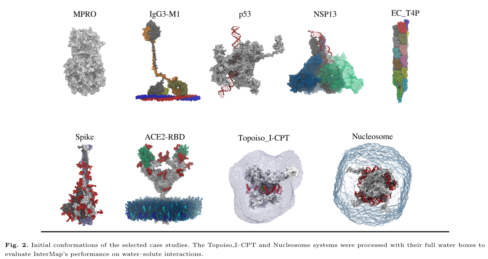

## 二、三把加速钥匙：InterMap 的核心技术

InterMap 的三个优化分别打在**查询（算法）、执行（编译）、存储（内存）**三个环节上，再靠 SMARTS 化学定义与 MDAnalysis 生态解决"能用、好用"的问题。

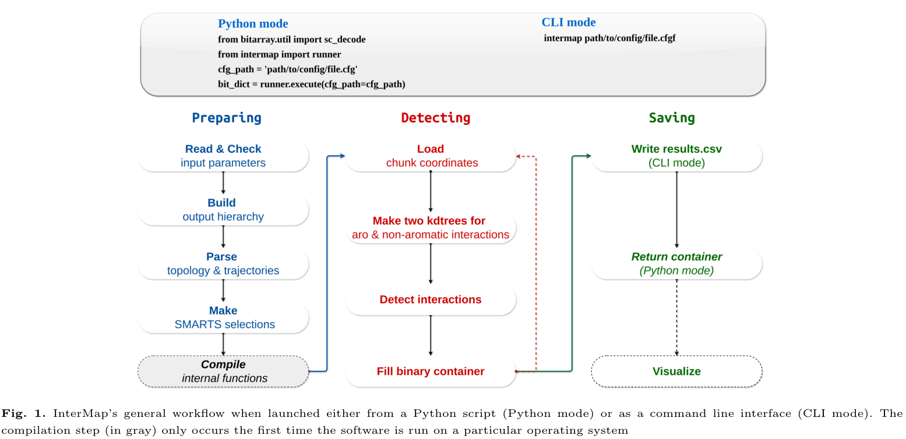

### 2.1 钥匙一：k-d 树把距离查询从 O(N²) 拉低

IFP 检测的瓶颈是海量距离/角度计算，朴素做法是 O(N²) 双重循环。k-d 树（Bentley, 1975）是一种高维空间二叉搜索树，邻居搜索平均复杂度 O(log N)、最差 O(N)[8]，能显著削减距离查询成本。

InterMap 的做法是**每帧构建两棵 k-d 树**：一棵给芳香交互（涉及原子少、截断距离大，如 π-堆积的 5.5–6.5 Å），一棵给非芳香交互（原子多、截断距离短）。分离的理由是 k-d 树查询性能随截断距离和邻居数增加而下降，分开后各自能在最优参数区间运行。由于标准 Python/Numba 生态没有原生 k-d 树，实现采用 `numba-kdtree` 库。论文对自身定位的措辞也值得注意：它把 k-d 树描述为 IFP 计算中"**此前被低估**"（under-exploited）的选择，而非声称首创。

### 2.2 钥匙二：Numba JIT 把关键循环变成机器码

Numba 将 Python/NumPy 关键循环即时编译为机器码，并在多核 CPU 上并行执行，无需额外内存开销。需要说明的是，InterMap 的三步流水线（载入坐标、检测交互、存储结果）中，**只有"检测"一步是并行的**——载入与存储仍是全流程瓶颈。这个设计直接决定了后面的调优策略。

### 2.3 钥匙三：位数组把指纹压到 1 bit/交互

主流科学库（NumPy、SciPy、TensorFlow）的最小存储单元是 byte（8 bit）。InterMap 用 `bitarray` 项目把每个交互状态存成 **1 bit**，内存占用省 8 倍；稀疏指纹还会做进一步压缩，避免零值浪费。分辨率上支持原子级与残基级两种：残基级把原子交互聚合到残基对，存储条目更少、更快更省；原子级更细，但更贵。

### 2.4 化学定义：SMARTS 模式，而非命名约定

InterMap 支持 12 类交互（范德华、近距离接触、疏水、阳/阴离子、金属配位、π-阳/阴离子、面面与边面 π-堆积、氢键、卤键、水桥），几何定义见 Table 2。举几个默认值：近距离接触 3.0 Å、疏水 4.5 Å、阳/阴离子 4.5 Å、金属 2.8 Å、π-阳/阴离子 4.5 Å、面面 π-堆积 5.5 Å、边面 6.5 Å、氢键 3.5/2.5 Å 加角度、卤键 2.5 Å；水桥定义为同一水分子通过氢键同时桥接两个残基。

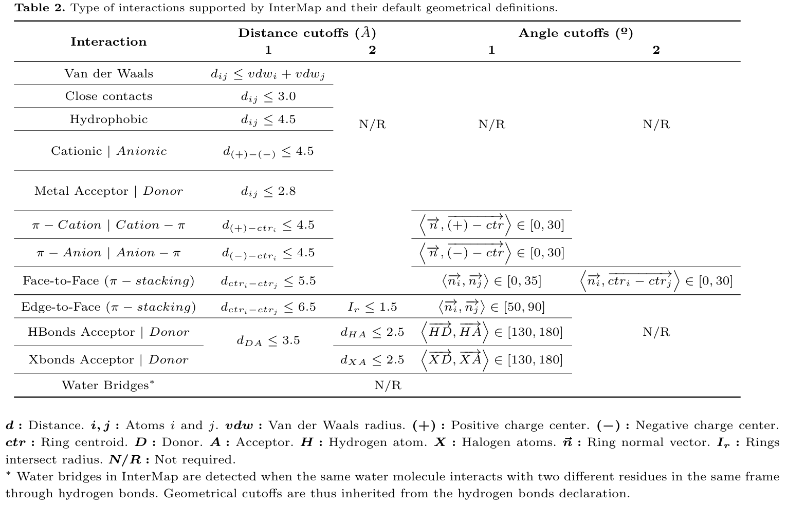

参与判定的原子由 SMARTS 模式从拓扑中提取。SMARTS 是描述分子模式的正则表达式语言，好处是**基于化学拓扑而非残基/原子命名约定**，跨力场通用；用户还可以自定义截断距离与交互子集。这部分通过 MDAnalysis 与 RDKit 的集成实现。

### 2.5 生态：MDAnalysis 兼容与双模式工作流

InterMap 继承 MDAnalysis 的格式兼容性与选择语法，支持多副本提交，并允许通过自定义拓扑注释文件标注非重叠原子集。运行上提供两种入口：CLI 模式面向非专家与批处理，输出 .PICKLE 文件；Python 模式返回压缩位数组字典，适合嵌入自动化管道。首次运行会编译并缓存 Numba 函数，后续直接复用。

## 三、性能基准：9 个真实系统，一张 Table 4 讲透

### 3.1 测试设计

论文选取 9 条真实 MD 轨迹作基准（Table 3），体系从约 4,700 原子的小蛋白到超过 18 万原子的复合物：病毒主蛋白酶（MPRO，其 IFP 为蛋白内部交互）、免疫球蛋白与细菌 M1 蛋白的复合物（IgG3-M1）、大肠杆菌 IV 型菌毛（Ec T4P）、刺突受体结合域与 ACE2 的复合物（ACE2-RBD）属于蛋白-蛋白体系；肿瘤抑制蛋白 p53、SARS-CoV-2 非结构蛋白 13（NSP13）、核小体（Nucleosome，147 碱基对 DNA 缠绕组蛋白八聚体）属于蛋白-DNA 体系；人拓扑异构酶 I 与 DNA、喜树碱的三元复合物（Topoiso I-CPT）属于蛋白-DNA-配体体系；刺突糖蛋白三聚体（Spike）为糖蛋白体系。原子数从 4,682 到 181,482，帧数从 10,000 到 207,571。各体系的 IFP 原子选择分组（蛋白/非蛋白、DNA、配体等）以 Table 4 为准——例如 ACE2-RBD 在基准中的选择即为"蛋白 vs 非蛋白"两组。其中 Topoiso I-CPT 与 Nucleosome 使用完整水盒运行，专门考验水-溶质交互。

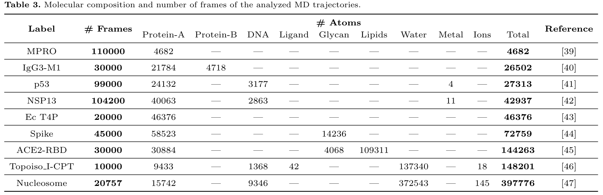

值得强调的是测试环境：一台 6 核台式机（AMD Ryzen 5、64 GB DDR4），不是集群——这使结果对普通工作站有直接参考意义。对比对象是 ProLIF v2.0.0、getContacts、MD-LR v1.0 与 MD-IFP v1.1。

### 3.2 三种"失败模式"：怎么读 Table 4

Table 4 把四款工具的时间、内存与检出数都在一张表里面。

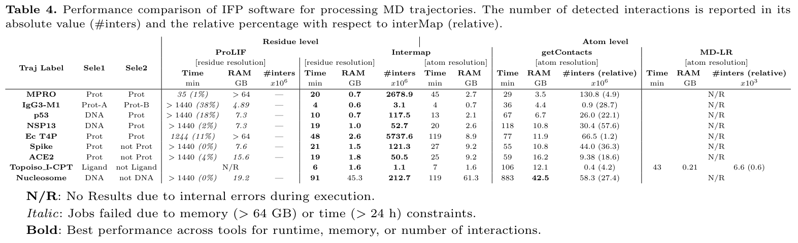

- **跑不完**：ProLIF 在多数轨迹上超过 24 小时上限或冲破 64 GB 内存。MPRO 只完成 1% 的分析就用掉 35 分钟，按线性外推完整分析约需 3,500 分钟；Spike 与 Nucleosome 加载一天都无法开始。
- **跑得完，但慢且检出少**：getContacts 用时从 29 分钟（MPRO）到 882 分钟（Nucleosome），比 InterMap 慢 4–10 倍；检出的交互数量尤其少，MPRO 上只有 InterMap 的 4.9%（1.308 亿 vs 26.8 亿），Ec T4P 上更只有 1.2%。论文指出，这一差距部分源于**交互定义口径的根本差异**，不能完全当作性能对比；但即便只看性能与内存，getContacts 也占不到便宜——Ec T4P 上它用 11.9 GB 检出 6,649 万条交互，InterMap 的检出数约为其 86 倍、内存反而更低（8.9 GB）。
- **直接失败**：MD-LR 在多数轨迹上内部错误（N/R），仅在其作者提供的 Topoiso I-CPT 上跑通（43 分钟），且只检出 InterMap 的 0.6%；MD-IFP 受架构限制，9 条轨迹一条都处理不了。

### 3.3 InterMap 的成绩（时间 / 内存 / 检出数）

残基级模式下，InterMap 在全部轨迹上都是最快的一个：最快 3 分钟（IgG3-M1），最慢 91 分钟（Nucleosome）；内存大多数体系稳定在 0.6–2.6 GB（Nucleosome 例外，残基级 45.3 GB）。在 MPRO 上，ProLIF 内存触顶 64 GB，而 InterMap 只用 0.7 GB——**91 倍**的内存差距。检出数量上，InterMap 也显著多于竞品。论文对整体优势的表述是：相比既有工具，执行时间与峰值内存**最高（up to）削减 99%**，部分场景呈现两到三个数量级的提升。此外，原子级模式虽然比残基级更费资源，但在基准中仍优于全部竞品，适合需要更高解析度的分析；两档分辨率可以搭配使用：残基级做快速探索，原子级做精细研究。

### 3.4 与 ProLIF 的 IFP 一致性

仅看性能不够，结果对不对也要检验。论文用 MPRO 轨迹 1000 个等距帧对比了 InterMap 与 ProLIF 的残基级 IFP（Fig 3）：π-阳离子、阳离子-π、阴离子、阳离子四类交互，两工具逐帧完全一致；其余类型存在微小差异，且成因都能合理解释——vdW/疏水上 InterMap 检出了更多落在截断距离内、化学上合理的接触（ProLIF 漏报）；氢键上 ProLIF 偶尔把肽键酰胺氮误判为受体（酰胺氮因共振稳定化只能作供体）；π-堆积的面/边面分类差异源于芳香环法向量构建所用的原子集不同。论文结论：这些差异不影响科学结论，InterMap 的检测更全面。

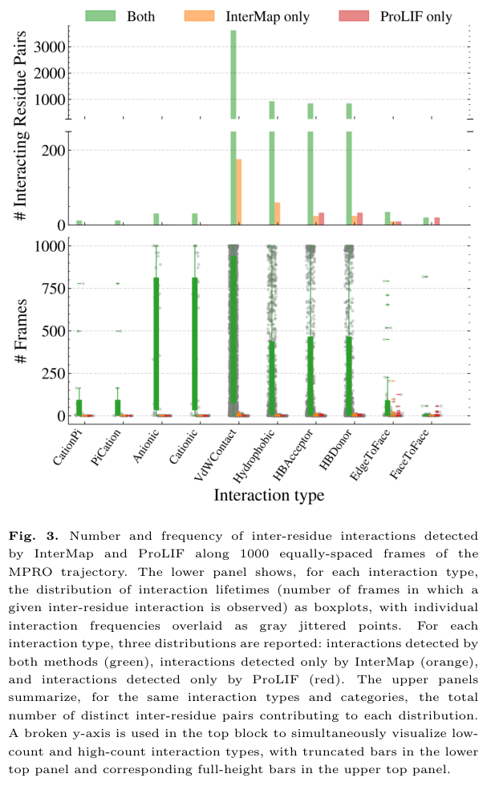

### 3.5 可扩展性权衡：分块与处理器怎么配

论文还专门做了可扩展性分析（Fig 4，MPRO 5 万帧）：三步流水线里只有检测并行，**存储是全流程最慢的一步**。分块大小（一次载入 RAM 的帧数）增大→磁盘读取次数减少→显著提速，但超过阈值后收益递减；处理器数量带来的加速**非线性且保守**，加太多只涨内存。论文给出的实操建议：**分块大小约等于处理器数量**；内存受限时两者一起调小。

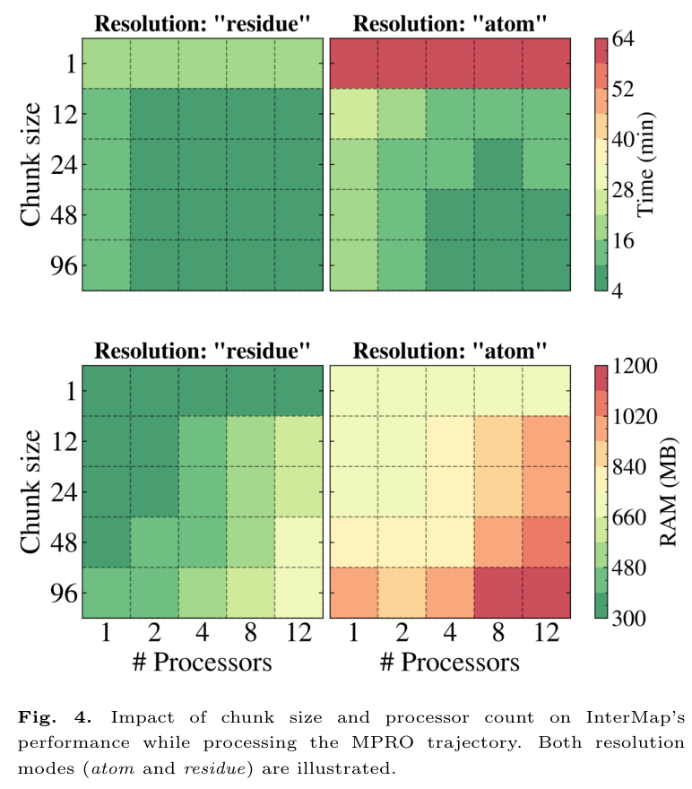

## 四、InterVis：把分析变成可点的图

InterMap 附带一个本地托管的 Shiny Web 应用 InterVis。它只需两个输入——运行时的配置文件和 .PICKLE 输出——通过内部映射把拓扑对应到原子标签。过滤维度有四个：交互类型、原子注释、占有率截断、MDAnalysis 原子选择。图表有五类（各占一个标签页）：两选择之间的 2D 交互热图、Selection 1/2 的交互流行度条形图、交互寿命分布箱线图、逐帧交互存在性时间序列、以及残基-交互网络图（节点=残基、边=交互，颜色编码类型、线宽编码流行度）。图像可导出 PNG，过滤后的数据可导出 CSV 供外部绘图。

因为全程本地运行、不依赖 Web 服务器，敏感数据不出本机，也便于接入自动化工作流。

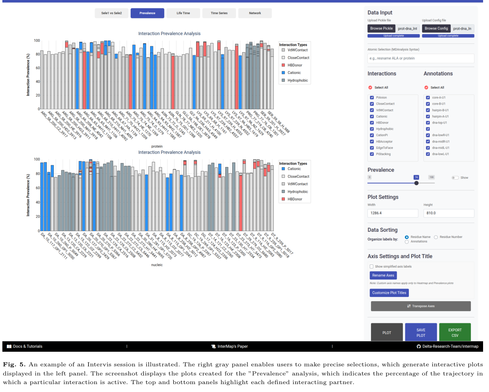

## 五、上手实践

安装（仓库与文档见 [9]）：

```bash
pip install git+https://github.com/Delta-Research-Team/intermap.git
```

Python API 示例：

```python
from bitarray.util import sc_decode
from intermap import runner

cfg_path = "path/to/config_file.cfg"
bit_dict = runner.execute(cfg_path=cfg_path)
```

CLI 模式：

```bash
intermap path/to/config_file.cfg
```

配置文件的关键参数：拓扑与轨迹路径（MDAnalysis 可识别的扩展名）、两个原子选择（MDAnalysis 语法）、交互类型子集、原子级/残基级分辨率、分块大小与处理器数量、可选的自定义拓扑注释文件。

调优速查：分块大小 ≈ 处理器数量；内存受限时两者调小；首次运行会编译缓存、后续复用；大体系先用残基级做探索性分析。接口可能随版本调整，以文档站为准。

## 六、客观评估：优势、边界与生态位

### 6.1 优势

- **算法层**：k-d 树把分子内 IFP 从"几乎算不动"变成常规操作，这是全文核心卖点
- **实现层**：Numba JIT + 位压缩，时间与内存双低；9 条轨迹全部跑完，竞品大面积失败
- **生态层**：MDAnalysis 格式兼容 + SMARTS 化学定义（不依赖命名约定）+ RDKit；双分辨率、双模式
- **可视化层**：InterVis 本地部署、数据可控
- **工程层**：src 布局、tests/、tox/pre-commit、mkdocs 文档站、MIT License——规范的科研开源

### 6.2 边界

- **性能数字口径**：论文的"最高（up to）99%"是最好情况；Nucleosome 级大体系内存仍可观（残基级 45.3 GB）
- **存储是瓶颈**：检测已高度优化，但载入/存储决定上限；处理器加速非线性
- **对比口径**：getContacts 检出少部分源于交互定义差异，跨工具比较要读注释
- 依赖 MDAnalysis 的格式支持范围；首次运行需要编译缓存

### 6.3 生态位

- vs ProLIF：分子内 IFP 与超大规模轨迹上的性能优势最明显
- vs getContacts：不依赖 VMD、命名约定灵活、配体交互完整
- vs MD-LR：支持核酸独立配体、分子内 IFP、非 GROMACS 格式
- vs MD-IFP：支持任意生物分子组合与分子内 IFP

## 参考资料

[1] Fajardo-Díaz E, Bignon E, Dehez F, Karami Y, González-Alemán R. InterMap: Accelerated Detection of Interaction Fingerprints on Large-Scale Molecular Ensembles. Journal of Chemical Theory and Computation, 2026, 22(14): 7370-7381. https://doi.org/10.1021/acs.jctc.6c00083（bioRxiv 预印本：https://doi.org/10.64898/2025.12.15.694195）
[2] Li Z, Huang R, Xia M, Patterson T A, Hong H. Fingerprinting Interactions between Proteins and Ligands for Facilitating Machine Learning in Drug Discovery. Biomolecules, 2024, 14(1): 72. https://doi.org/10.3390/biom14010072
[3] Bouysset C, Fiorucci S. ProLIF: a library to encode molecular interactions as fingerprints. Journal of Cheminformatics, 2021, 13: 72. https://doi.org/10.1186/s13321-021-00548-6
[4] getContacts. https://getcontacts.github.io/
[5] MD-IFP. HITS-MCM/MD-IFP. https://github.com/HITS-MCM/MD-IFP
[6] Pieroni M, et al. MD-Ligand-Receptor: A High-Performance Computing Tool for Characterizing Ligand-Receptor Binding Interactions in Molecular Dynamics Trajectories. International Journal of Molecular Sciences, 2023, 24(14): 11671. https://doi.org/10.3390/ijms241411671
[7] Jaeger-Honz S, Klein K, Schreiber F. Systematic Analysis, Aggregation and Visualisation of Interaction Fingerprints for Molecular Dynamics Simulation Data. Journal of Cheminformatics, 2024, 16. https://doi.org/10.1186/s13321-024-00822-3
[8] Bentley J L. Multidimensional binary search trees used for associative searching. Communications of the ACM, 1975, 18(9): 509-517. https://doi.org/10.1145/361002.361007
[9] InterMap. Delta-Research-Team/intermap. https://github.com/Delta-Research-Team/intermap

---

## Others

重庆槽谷里面难得的一个大雨之夜。我总觉得这个地方风水不好，槽谷里面既不藏风也不聚气。

最近在做一些相互作用的小工作，调研的时候翻到了这篇文章，第一眼看上去还挺震惊的！要鉴定一个相互作用，方法有很多，实现的途径也有很多，现在有了AI了，那就更容易了。给AI一个一帧的pdb文件，它一定会有很多方法帮你找出来其中的各类相互作用。但是只有自己做过大规模MD里面的相互作用检测，就会明白，帧数上去之后，这就纯是一个算法优化的问题。这需要很好的计算机和软件工程的底子，或者说算法和数据结构的底子。而类似于我们这种野路子，只能说道听途说了一点儿计算机基础，所以做起来会很难。几年前自己写相关的工具的时候就很多次遇到过类似的效率问题，自己实现和优化起来确实是很麻烦的。沉下心好几天写几百行代码去优化一个简单的逻辑，最后得到了一些小小的效率提升，那会很开心。现在有了AI，对于这类边界清晰、验收条件明明白白的问题，我们或许能够说是有条件“彻底”解决的。

这篇文章，可以说是对极致工程效率不懈追求的一个案例。当然，也不能对它极尽赞美，这只是一个“1+1=99”的工作，几个核心的东西（KDTree、JIT、bit存储)没有一个是这篇文章原创的算法，但是组合起来，效率到了一个全新的台阶。这就好像大家还苦哈哈蹬自行车呢兄弟你开上小汽车了，我只能给你99分，剩下一分等你开上roadster再说。

我们逐个来看文章宣称的创新点，其实都不算特别厉害。

首先是KDTree，这是本文的核心，最重要的效率提升就来自于这个算法。类似的算法还有很多，改天单独撰文和大家讨论。就论KDTree，这篇文章也不是第一个将之应用到MD的，据我所知，MDAnalysis里面是早就内置了KDTree算法（十年之前0.11.0版本就有了），而且还能自动处理PBC。所以我可能也会偷偷怀疑，这文章是不是发现MDAnalysis里面有这个算法，然后拿来用用，发现“哇，牛逼”，于是就有了这个故事。

Numba JIT 编译，这没啥好说的，完全是和专业领域无关的，python计算里面常见且常用的一个提速手段。

位数组（1 bit）压缩存储，这个也常见，但是对于我们来说很难想到。对于追求极致来说，这确实是一个巧思。但速度上去了，结果解析和复用的成本也提升了，双刃剑。

至于MDAnalysis+SMARTS，拜托，ProLIF也是这样的，谁还能绕过去MDAnalysis和RDkit呢？

还有InterVis 本地交互式可视化，好吧，意思是服务器用不了了，我得把分析结果下载到本地，然后本地还得搭一下环境然后才能可视化。

所以，每一个看起来都没啥意思，合起来做出来的结果还挺厉害的。从最初的预印本来看，作者好像是想投核酸研究NAR的，后来在JCTC上发表了，其实我觉得应该更适合JCIM，感觉上是没有那么“Theory and Computation”的。当然，也可能我对JCTC有误解，也可能是因为我熟悉这部分东西，圣经里面说“乡人眼里无圣人”嘛哈哈哈。

这篇文章最终目的是落在IFP上，我对这个不太熟悉，印象里几年前看过一篇PLIP作者参与的文章，里面有一个指纹，大概可能类似于这样吧。哦，找到了，是这一篇：

> Juárez-Saldivar A, Schroeder M, Salentin S, Haupt VJ, Saavedra E, Vázquez C, Reyes-Espinosa F, Herrera-Mayorga V, Villalobos-Rocha JC, García-Pérez CA, Campillo NE, Rivera G. Computational Drug Repositioning for Chagas Disease Using Protein-Ligand Interaction Profiling. Int J Mol Sci, 2020, 21(12): 4270. DOI: 10.3390/ijms21124270（PMID 32560043）

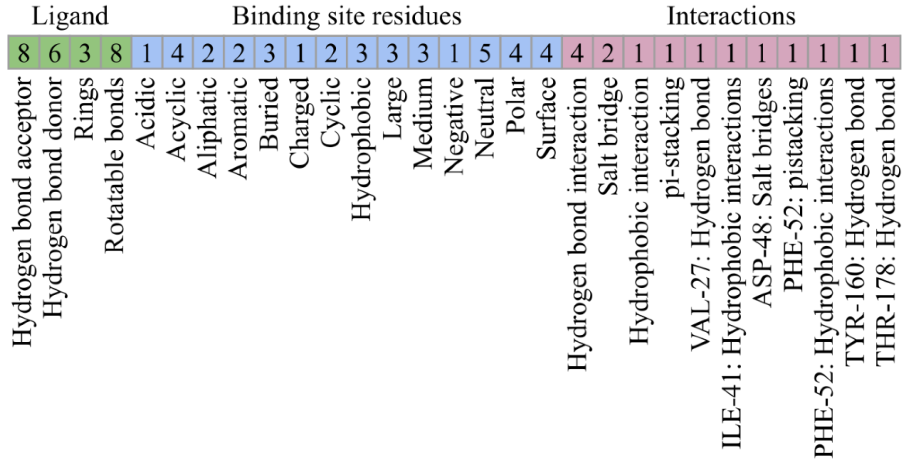 

几个工具横评的部分也不错，今年看到的好些工具文章都没有测评（尤其是JCIM上的几个application note)，看完之后感觉就像是吃凉面但是没有调料，干嗦油滋滋的面条，这他妈谁受得了啊！其实文章里测评的几个工具，对相互作用的定义都不一致、甚至连参与相互作用的基团的鉴定方法都有差异，因而文章里提到的检出数不一样，那简直是天经地义就该如此的。哈哈哈哈，我突然想到，不会是想要投NAR所以得搞一节测评，不然没得发吧哈哈哈哈哈。代码仓库我也去扒拉了一下，24年底第一个提交，大概率老老实实手搓了很长时间。这两个github仓库的协作者，从规范性上来看，素质应当是相当不错的，可能还有些MATLAB的使用经验，或许是数值计算的老手了哈哈哈哈。


文章前言里面讲到说生产轨迹的能力现在已经大大的，但是分析轨迹的能力现在还是小小的。我也一直有这种感觉。MD一定是服务于科学问题的，带着问题去做建模、run轨迹、针对性的分析。好多好多的教程介绍如何建模、如何采样，到了分析部分，好的，就只有gmx单条命令直出的那些老面孔了，RMSD、RMSF、Rg、SASA，就打完收工了，屁用不顶。看看生信里面那些花里胡哨的分析，牛皮吹得天花乱坠，故事比童话都美好。MD这边，在好期刊上还是能看到一些精彩的分析，但很多时候，综合性子刊、小文章上，就经常比较糊弄，总有种隔靴搔痒的感觉。当然我也隔靴搔痒，因为我发不了大文章orz。从大量的轨迹里面，去做有意思的分析，得到有意思的故事，这还挺有趣的。以后AI生成动态系综的工具也会越来越多，也同样会产生大量的分析的需求。

好啦，用我的可爱大肥鱼写的金句来收尾吧：："把查询从 O(N²) 降到 O(log N)，有时候慢的不是算法，是没人想起用它。"


刚写完雨就不下了，我还想听着雨声睡觉呢。我就说槽谷风水不好！气死偶嘞~


